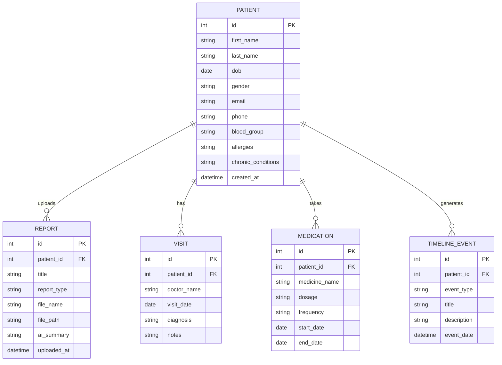
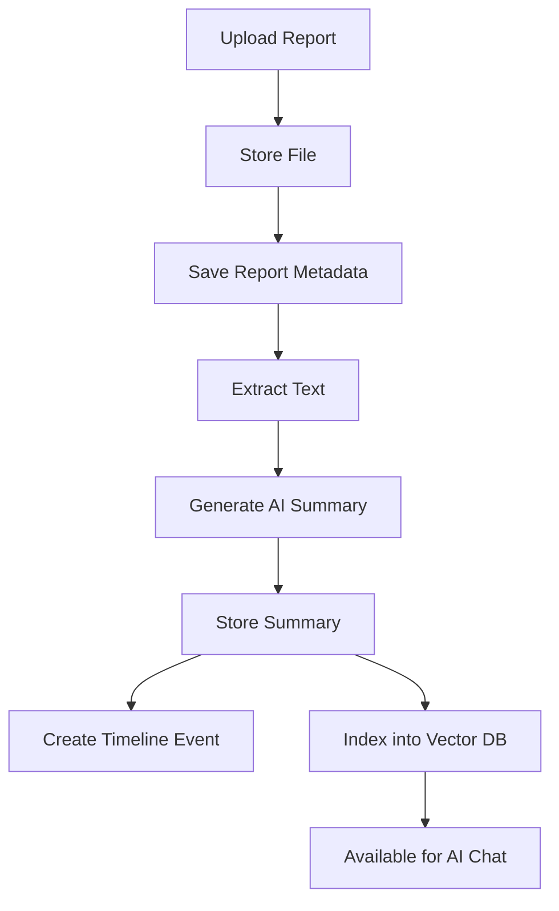

This is exactly how I would approach it if I were designing the project from scratch. Before writing any code, **design the domain model and API**. Once this is done, implementation becomes straightforward.

We'll build the project in layers:

```
Database (Models)
        ↓
Schemas (Pydantic DTOs)
        ↓
Repository
        ↓
Service
        ↓
API (Router)
        ↓
Frontend
```

---

# Overall Architecture

```text
                    React Frontend
                           │
                     HTTP / JSON
                           │
                    FastAPI Router
                           │
                       Service Layer
                           │
                   Repository Layer
                           │
                    SQLAlchemy Models
                           │
                        SQLite DB
                           │
               (Later AI/RAG Components)
```

Once CRUD is complete, the AI layer simply consumes these services.

---

# Phase 1 Database Design

We'll normalize the database instead of storing everything in one table.

## Entity Relationship Diagram (ERD)



---

# Models

These are your SQLAlchemy models (Spring Entities).

## 1. Patient

Fields

```
id
first_name
last_name
dob
gender
email
phone
blood_group
allergies
chronic_conditions
created_at
```

Relationships

```
reports

visits

medications

timeline_events
```

---

## 2. Report

Represents uploaded medical files.

```
id

patient_id

title

report_type

file_name

file_path

extracted_text

ai_summary

uploaded_at
```

Later we'll add:

```
embedding_status

ocr_status

vector_document_id
```

---

## 3. Visit

```
id

patient_id

doctor_name

visit_date

diagnosis

notes
```

---

## 4. Medication

```
id

patient_id

medicine_name

dosage

frequency

start_date

end_date
```

---

## 5. TimelineEvent

Instead of generating timelines every time, we'll store important events.

```
id

patient_id

event_type

title

description

event_date
```

Examples

```
Blood Test Uploaded

MRI Uploaded

Medication Added

Follow-up Visit

Diabetes Diagnosis
```

---

# Schemas (Pydantic)

Every entity gets four schemas.

Example using Patient:

```
PatientCreate

PatientUpdate

PatientResponse

PatientListResponse
```

Do the same for every entity.

---

## Patient Schemas

```
PatientCreate
```

Used in POST

Contains

```
first_name

last_name

dob

gender

email

phone

blood_group

allergies

chronic_conditions
```

---

```
PatientUpdate
```

Everything optional.

---

```
PatientResponse
```

Contains

```
id

all fields

created_at
```

---

```
PatientListResponse
```

```
list[PatientResponse]
```

---

Repeat the same pattern.

### Report

```
ReportCreate

ReportUpdate

ReportResponse
```

---

### Visit

```
VisitCreate

VisitUpdate

VisitResponse
```

---

### Medication

```
MedicationCreate

MedicationUpdate

MedicationResponse
```

---

### Timeline

```
TimelineCreate

TimelineResponse
```

---

# Repository Methods

Think of this exactly like Spring Data JPA.

---

## PatientRepository

```
create()

find_all()

find_by_id()

update()

delete()

find_by_email()

exists()

search()
```

---

## ReportRepository

```
upload()

find_by_id()

find_patient_reports()

delete()

update_summary()
```

---

## VisitRepository

```
create()

find_patient_visits()

delete()
```

---

## MedicationRepository

```
create()

find_patient_medications()

update()

delete()
```

---

## TimelineRepository

```
create()

find_patient_events()
```

---

# Service Layer

Business logic.

---

## PatientService

Responsibilities

```
Validate email uniqueness

Create patient

Update patient

Delete patient

Get patient

Search patient
```

---

## ReportService

```
Upload report

Save metadata

Read report later

Generate AI summary (future)

Delete report
```

---

## VisitService

```
Create visit

Update notes

Delete visit
```

---

## MedicationService

```
Add medicine

Update medicine

Remove medicine

Check duplicates (future)
```

---

## TimelineService

```
Create event

Return timeline sorted by date
```

---

# APIs

## Patient

```
POST   /patients

GET    /patients

GET    /patients/{id}

PUT    /patients/{id}

DELETE /patients/{id}
```

Extra

```
GET /patients/search?name=John

GET /patients/email/test@gmail.com
```

---

## Reports

```
POST /reports/upload

GET /reports

GET /reports/{id}

GET /reports/patient/{patient_id}

DELETE /reports/{id}
```

Later

```
POST /reports/{id}/summarize
```

---

## Visits

```
POST /visits

GET /visits/patient/{patient_id}

PUT /visits/{id}

DELETE /visits/{id}
```

---

## Medications

```
POST /medications

GET /medications/patient/{patient_id}

PUT /medications/{id}

DELETE /medications/{id}
```

---

## Timeline

```
GET /timeline/{patient_id}
```

---

# Folder Structure

```
src/hartwell_backend

├── api
│   ├── patient_api.py
│   ├── report_api.py
│   ├── visit_api.py
│   ├── medication_api.py
│   └── timeline_api.py
│
├── models
│   ├── patient.py
│   ├── report.py
│   ├── visit.py
│   ├── medication.py
│   └── timeline.py
│
├── repositories
│   ├── patient_repository.py
│   ├── report_repository.py
│   ├── visit_repository.py
│   ├── medication_repository.py
│   └── timeline_repository.py
│
├── schemas
│   ├── patient.py
│   ├── report.py
│   ├── visit.py
│   ├── medication.py
│   └── timeline.py
│
├── services
│   ├── patient_service.py
│   ├── report_service.py
│   ├── visit_service.py
│   ├── medication_service.py
│   └── timeline_service.py
```

---

# Development Order

I recommend implementing in this order so every step builds on the previous one:

```
1. Database connection
        ↓
2. Patient Model
        ↓
3. Patient Schemas
        ↓
4. Patient Repository
        ↓
5. Patient Service
        ↓
6. Patient API
        ↓
7. Test CRUD in Insomnia
        ↓
8. Report Model
        ↓
9. Report Upload
        ↓
10. Visit
        ↓
11. Medication
        ↓
12. Timeline
        ↓
13. AI Integration
        ↓
14. RAG
        ↓
15. LangGraph Agents
```

## One design recommendation

One thing I'd add that isn't in your original plan is a **`Report`-centric architecture**. Most of the AI functionality revolves around uploaded reports, so after the CRUD foundation, the flow should look like this:



This keeps the system modular: the CRUD layer manages patients and reports, while later AI features simply plug into the report pipeline without changing your core architecture. That separation will make the project easier to maintain and much easier to explain in interviews.
